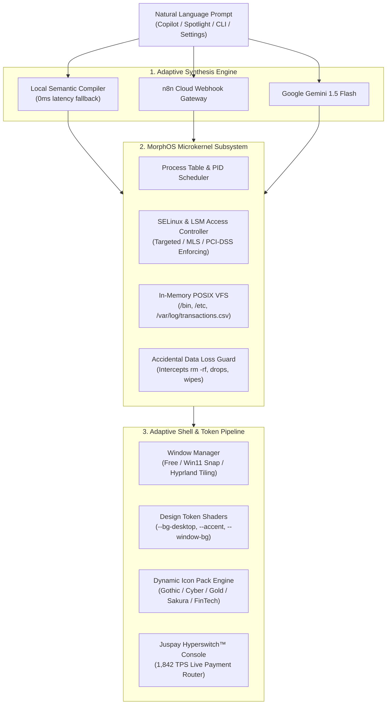

# 🌌 MorphOS — Prompt-Synthesized Adaptive Operating System

> 🌐 **Live Production Deployment**: **[https://morphos-zic5.onrender.com](https://morphos-zic5.onrender.com)**  
> **Built for the Juspay "Ship Happens" Hackathon (Bangalore, 2026)**  
> **Primary Track**: Track 01 (Cloud Nine | AWS + Kiro)  
> **Secondary Track**: Track 03 (Trust Issues | Failproof AI & Zero Accidental Data Loss)

[](https://morphos-zic5.onrender.com)
[](https://vitejs.dev/)
[](https://react.dev/)
[](https://www.typescriptlang.org/)
[](https://tailwindcss.com/)
[](https://github.com/pmndrs/zustand)
[](https://aws.amazon.com/)

---

## 💡 What is MorphOS?

In traditional computing, an Operating System is static. If a **Juspay FinTech SRE**, an **intern**, and a **compliance auditor** log into a machine, they receive the exact same desktop environment, leaving production payment switches vulnerable to developer accidents (`rm -rf /`, `DROP TABLE`) and audit violations.

**MorphOS** is the world's first **Prompt-Synthesized Operating System**. With a single natural language prompt like:
> *"Make this OS according to Juspay business with Hyperswitch routing and PCI-DSS compliance"*  
> or  
> *"Gothic obsidian dark theme with blood-crimson icons and strict root privilege rings"*

...the entire operating system dynamically recompiles its **window compositor, desktop shader canvas, every single app/dock icon, SELinux policies, and active telemetry tools in real time**.

---

## ⚡ Core Capabilities

### 1. 💳 Juspay Hyperswitch™ Financial Orchestration
- **Live Payments Stream**: Real-time routing feed processing **1,842 TPS** across Indian merchants (**Swiggy, Flipkart, Cred, Zepto, Uber Bangalore**).
- **Multi-Bank Gateway Health**: Live SLA telemetry for **HDFC UPI, ICICI Direct, Axis Turbo, and SBI Switch**.
- **Interactive Smart Failover**: Simulate bank gateway degradations (e.g. SBI 504 timeout spikes) and trigger instant Hyperswitch ML auto-rerouting to HDFC & ICICI with 99.98% guaranteed uptime.
- **PCI-DSS 4.0 Level 1 Tokenization**: Click any transaction in the feed to inspect masked cardholder data (`4111-XXXX-XXXX-8921`) and cryptographic SHA-256 audit hashes.

### 2. 🛡️ LSM Accidental Data Loss Guard (Track 03: Failproof AI)
- **Zero Accidental Wipes**: If an autonomous agent or developer runs `rm -rf /`, `DROP TABLE transactions`, or attempts unauthorized modifications to `/etc/passwd`, the MorphOS microkernel LSM halts execution at the syscall layer.
- **Biometric / 2FA Sudo Challenge**: Critical system elevation requires biometric challenge resolution before modifying restricted hierarchies.
- **Cryptographic Audit Trail**: Every security intercept is logged to the in-memory immutable audit ledger with severity grading (`INFO`, `WARNING`, `CRITICAL`).

### 3. 🎨 Dynamic Design Token & Icon Engine
- MorphOS synthesizes **complete aesthetic architectures on the fly**:
  - **Desktop Canvas**: Dynamic CSS shader gradients & animated ambient orbs.
  - **Every Single Icon**: Copilot, Terminal, Files, Settings, Security, Notes, Hyperswitch, and Spotlight dynamically transform their **background gradient, border, glow luminescence, glyph color, and corner radius** (Sharp `0px` matrix blocks, Crimson obsidian gems, 24K Royal Gold, Sakura bubbles).
  - **Window Chrome**: Active window border luminescence and title bar controls adapt dynamically.

### 4. 🪟 Hybrid Window Compositor
- **macOS Sonoma Floating Glass**: Fluid spring physics, translucent backdrops, and floating magnifying dock.
- **Windows 11 Snap Quadrants**: Drag windows to screen edges to snap into split-screen and quadrant productivity layouts.
- **Arch Hyprland Auto-Tiling**: Automatic matrix terminal tiling layout with zero-latency boundaries.

### 5. ☁️ Dual-Engine Synthesis (Local + n8n Cloud + Gemini 1.5 Flash)
- **0ms Local Heuristic Engine**: Zero-latency offline resilience so the system never fails a live demo.
- **n8n Cloud Webhook Integration**: Cloud-orchestrated workflow execution.
- **Google Gemini API**: Extended natural language synthesis for arbitrary aesthetic prompts.

---

## 🏗️ Architecture



---

## 🚀 Live Demo & Quickstart

- 🌐 **Live Website**: **[https://morphos-zic5.onrender.com](https://morphos-zic5.onrender.com)**

### Running Locally
```bash
# Clone the repository
git clone https://github.com/Scafo745/MorphOS.git
cd MorphOS

# Install dependencies
npm install

# Start development server
npm run dev
```

Open [http://127.0.0.1:5173/](http://127.0.0.1:5173/) in your browser.

---

## 🎯 Hackathon Presentation Cheatsheet

### 1. The Juspay FinTech Workstation Demo
In **Morph Copilot** or **Spotlight** (`Ctrl+K`), type:
```
make this os according to juspay business
```
- Watch MorphOS instantly launch the **Juspay Hyperswitch™** payment router.
- Show live payments streaming at 1,842 TPS across Swiggy, Flipkart, Cred, and Zepto.
- Click **"Simulate SBI Degradation"** to demonstrate gateway latency spike, then click **"Hyperswitch Smart Failover"** to show instant ML re-routing.

### 2. The Accidental Data Loss Demo (Track 03)
In the Terminal, run:
```bash
rm -rf /
```
- Show the microkernel LSM intercepting the command and popping an emergency protection alert.

### 3. The Aesthetic Morph Demo
Type:
```
make the colors dark, like gothic theme with crimson red icons
```
- Watch the wallpaper, orbs, dock icons, desktop shortcuts, and window controls transform into blood-crimson obsidian glass.

---

## 🛠️ Built with Kiro & AWS

MorphOS was developed using **AWS Kiro** spec-driven development.
- Project specifications are persisted in `.kiro/spec.json`.
- Agent steering rules are located in `.kiro/steering/guidelines.md`.

---

## 📄 License
MIT License. Built for the Juspay "Ship Happens" Hackathon 2026.
