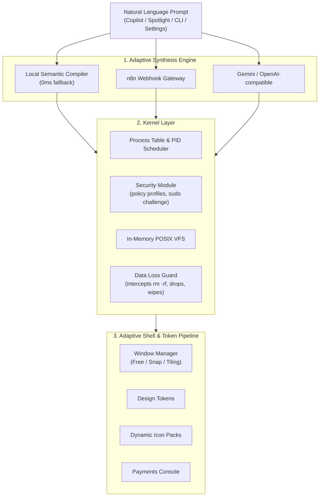

# 🌌 MorphOS: A Prompt-Adaptive Operating System

> **Live deployment**: [morphos-zic5.onrender.com](https://morphos-zic5.onrender.com)

[](https://morphos-zic5.onrender.com)
[](https://vitejs.dev/)
[](https://react.dev/)
[](https://www.typescriptlang.org/)
[](https://tailwindcss.com/)
[](https://github.com/pmndrs/zustand)

---

## 💡 What is MorphOS?

Traditional operating systems are static: everyone gets the same desktop, the same defaults and the same tooling, whatever they actually need.

**MorphOS** is a **prompt-adaptive operating system**. You describe what you need, and the OS reshapes itself around it. For example:

> *"I need an operating system which prioritizes gaming more than anything else."*

The OS responds by reconfiguring its theme, window manager, security policy, bundled apps and tooling to fit that goal. The same idea works for developer workstations, fintech and compliance setups, security-hardened systems, or purely aesthetic requests.

### MVP scope

The long-term goal is to make this adaptation happen at the kernel level. This MVP does not do that yet. Today MorphOS adapts the **shell, window manager, design tokens, security policy and bundled apps** in the browser.

---

## ⚡ Capabilities

- 🎨 **Dynamic design tokens and icon packs**: wallpaper shaders, ambient orbs, window chrome and every dock/desktop icon are rebuilt from the prompt (gothic, matrix, gold, sakura, synthwave, fintech and more).
- 🪟 **Window compositor modes**: macOS-style floating glass, Windows 11 snap quadrants, and Hyprland-style auto-tiling.
- 🛡 **LSM data-loss guard**: destructive actions such as `rm -rf /` or `DROP TABLE` are intercepted. Critical elevation requires a sudo challenge, and every intercept lands in an audit trail with severity grading.
- 💳 **Payments console**: live payments stream (1,842 TPS), multi-bank rails (HDFC, ICICI, SBI, Axis), simulated gateway degradation with smart failover, and PCI-DSS 4.0 masked transaction audits.
- 🤖 **Copilot with tool use**: reconfigures the OS, inspects processes, runs security checks and answers general questions.
- 🌐 **In-OS browser** with AI search.
- 📦 **Simulated package manager** in the terminal.
- ☁ **Multi-provider AI with failover**: a zero-latency local heuristic engine, n8n webhook, Gemini and OpenAI-compatible providers.

---

## 🏗 Architecture



---

## 🚀 Quickstart

```bash
git clone https://github.com/Scafo745/MorphOS.git
cd MorphOS
npm install
npm run dev
```

Open [http://127.0.0.1:5173/](http://127.0.0.1:5173/) in your browser.

---

## 🎯 Demo cheat-sheet

In **Morph Copilot** or **Spotlight** (`Ctrl+K`), try:

1. `make an operating system that prioritizes gaming above everything else`
2. `fintech workstation with PCI-DSS compliance`: launches the payments console. Try "Simulate SBI Degradation", then "Smart Failover".
3. `gothic theme with crimson icons`: the wallpaper, orbs, icons and window controls re-theme.
4. In the Terminal, run `rm -rf /` to watch the guard intercept it.

---

## 📄 License

MIT License.
